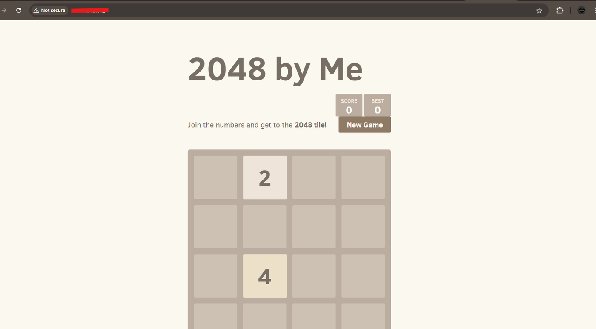
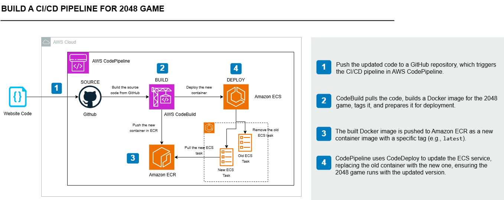
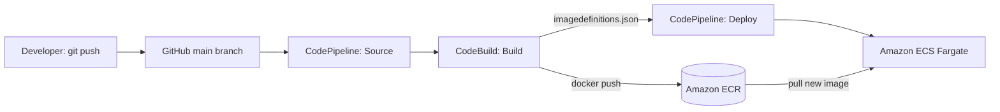
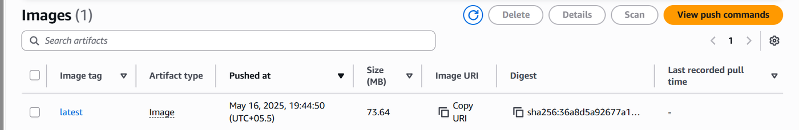
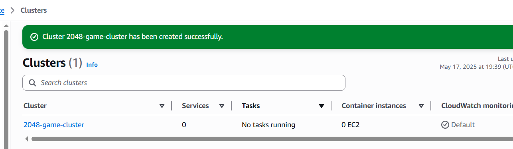
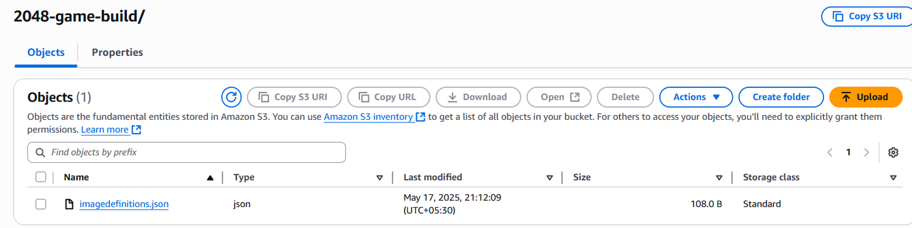
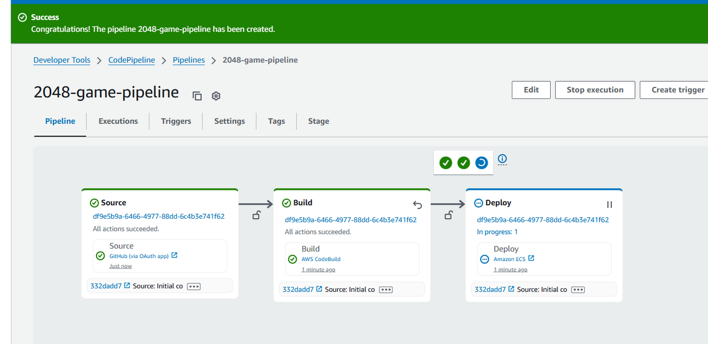
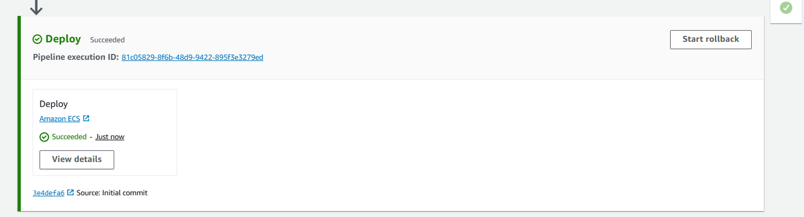
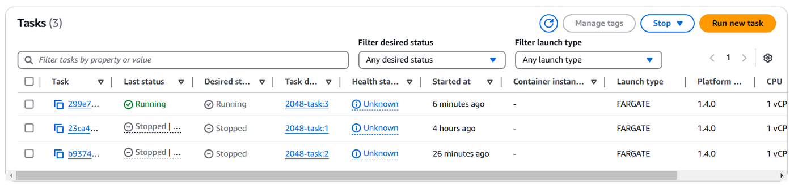

<div align="center">

# 🚀 Automated CI/CD Pipeline on AWS

### Docker · Amazon ECR · AWS CodeBuild · AWS CodePipeline · Amazon ECS Fargate

**One `git push` → built, containerized and deployed to AWS. Zero manual steps.**


[📖 Read the full walkthrough on dev.to](https://dev.to/shehzad_ahmad_153/building-a-fully-automated-cicd-pipeline-on-aws-with-docker-ecr-codebuild-codepipeline-and-ecs-189o) · [💼 Connect on LinkedIn](www.linkedin.com/in/shehzad-ahmad153)



</div>

---

## 📑 Table of Contents

- [Overview](#-overview)
- [Architecture](#-architecture)
- [Tech Stack](#-tech-stack)
- [Project Structure](#-project-structure)
- [How the Pipeline Works](#-how-the-pipeline-works)
- [Build It Yourself](#-build-it-yourself)
- [Pipeline in Action](#-pipeline-in-action)
- [Troubleshooting](#-troubleshooting)
- [Production Hardening](#-production-hardening)
- [Key Learnings](#-key-learnings)
- [Cost and Cleanup](#-cost-and-cleanup)
- [Credits](#-credits)

---

## 🎯 Overview

Manual deployments are slow and error-prone. This project replaces them with a fully automated delivery pipeline on AWS: every push to the `main` branch builds a Docker image, stores it in Amazon ECR and rolls it out to Amazon ECS on Fargate.

A static web app (the classic **2048 game**) is used as the workload so the focus stays on the pipeline itself, and a successful deployment is instantly visible in the browser.

| | |
|---|---|
| ⏱️ **Build time** | About 2 to 3 hours |
| 💰 **Cost** | About $1 or less |
| ✅ **Result** | Every push to `main` is built, stored and deployed automatically |

---

## 🏗️ Architecture

<p align="center">
  
</p>



---

## 🧰 Tech Stack

| Service | Role in the project |
|---|---|
| **GitHub** | Source control and pipeline trigger |
| **Docker + Nginx** | Packages and serves the app identically everywhere |
| **Amazon ECR** | Private registry that stores the Docker images |
| **AWS CodeBuild** | Managed build server that builds and pushes the image |
| **Amazon S3** | Stores build artifacts passed between stages |
| **AWS CodePipeline** | Orchestrates Source, Build and Deploy |
| **Amazon ECS (Fargate)** | Runs the container without servers to manage |
| **AWS IAM** | Scoped permissions between services |

---

## 📂 Project Structure

```text
2048-game-ci-cd/
├── Dockerfile        # Packages the static game with Nginx
├── buildspec.yml     # CodeBuild instructions: build, push, create imagedefinitions.json
├── index.html        # The 2048 game
├── js/               # Game logic
├── style/            # Stylesheets
├── meta/             # Icons and metadata
└── images/           # Screenshots from my run of the pipeline
```

---

## ⚙️ How the Pipeline Works

| Stage | Provider | What happens |
|---|---|---|
| 1️⃣ **Source** | GitHub | CodePipeline detects a push to `main` and fetches the code |
| 2️⃣ **Build** | AWS CodeBuild | Runs `buildspec.yml`: builds the image, pushes it to ECR, creates `imagedefinitions.json` |
| 3️⃣ **Deploy** | Amazon ECS | Uses `imagedefinitions.json` to roll out the new image on Fargate |

### The Dockerfile

```dockerfile
FROM nginx:latest
COPY . /usr/share/nginx/html
EXPOSE 80
CMD ["nginx", "-g", "daemon off;"]
```

### The buildspec

```yaml
version: 0.2

phases:
  pre_build:
    commands:
      - aws ecr get-login-password --region <your-region> | docker login --username AWS --password-stdin <ECR_URI>
  build:
    commands:
      - docker build -t 2048-game .
      - docker tag 2048-game:latest <ECR_URI>:latest
  post_build:
    commands:
      - docker push <ECR_URI>:latest
      - printf '[{"name":"2048-container","imageUri":"%s"}]' "<ECR_URI>:latest" > imagedefinitions.json

artifacts:
  files:
    - imagedefinitions.json
```

> 🔑 **Key detail:** `imagedefinitions.json` is the bridge between CodeBuild and ECS. The `name` must exactly match the container name in the ECS task definition, otherwise the Deploy stage fails.

---

## 🛠️ Build It Yourself

> 💡 **Tip:** deploy manually to ECS first. If it does not work by hand, a pipeline will only automate the failure.

1. **Containerize:** build and test locally with `docker build -t 2048-game .`
2. **ECR:** create a private repository, tag the image and push it.
3. **ECS (manual run):** create a Fargate cluster, a task definition (container `2048-container`, port 80) and a service with a public IP. Allow inbound HTTP (port 80) in the security group.
4. **IAM:** create a role for CodeBuild with ECR, S3 and CodeBuild access, plus an inline policy allowing only `ecs:UpdateService` and `ecs:DescribeServices` on your service.
5. **S3:** create a bucket for build artifacts.
6. **CodeBuild:** create a project connected to your GitHub repo that uses `buildspec.yml`. Run one build manually to test it.
7. **CodePipeline:** create a pipeline with Source (GitHub), Build (CodeBuild) and Deploy (Amazon ECS) stages.
8. **Test:** change something in `index.html`, then `git push` and watch it deploy.

The complete step-by-step guide with explanations is in the **[dev.to article](YOUR-DEVTO-LINK)**.

---

## 📸 Pipeline in Action

<table>
  <tr>
    <td align="center"><br><sub><b>Image stored in Amazon ECR</b></sub></td>
    <td align="center"><br><sub><b>ECS cluster created</b></sub></td>
  </tr>
  <tr>
    <td align="center"><br><sub><b>imagedefinitions.json stored in S3</b></sub></td>
    <td align="center"><br><sub><b>Pipeline with Source, Build and Deploy</b></sub></td>
  </tr>
  <tr>
    <td align="center"><br><sub><b>Deploy stage succeeded</b></sub></td>
    <td align="center"><br><sub><b>Rolling deployment: new task running</b></sub></td>
  </tr>
</table>

---

## 🧯 Troubleshooting

<details>
<summary><b>Build fails at the ECR login or push</b></summary>

The CodeBuild role is missing ECR permissions, or the region or repository URI in `buildspec.yml` is wrong.
</details>

<details>
<summary><b>Deploy stage fails</b></summary>

The container `name` in `imagedefinitions.json` does not match the container name in the task definition.
</details>

<details>
<summary><b>The site does not load on the public IP</b></summary>

The security group does not allow inbound port 80, or the service does not have a public IP enabled.
</details>

<details>
<summary><b>CodeBuild cannot update the ECS service</b></summary>

The resource ARN in the inline IAM policy does not match your ECS service.
</details>

<details>
<summary><b>The pipeline does not trigger on push</b></summary>

The Source stage points to a different repository or branch than the one you pushed to.
</details>

---

## 🔒 Production Hardening

This project is built for learning. For a real workload I would:

- [ ] Replace broad managed policies with **least-privilege, resource-scoped IAM policies**
- [ ] Pin the base image version and tag images with the **commit SHA**
- [ ] Add a **test stage** with linting and ECR image scanning
- [ ] Put an **Application Load Balancer** with HTTPS in front of the service
- [ ] Define the infrastructure with **Terraform or CloudFormation**
- [ ] Use a **GitHub App connection (CodeConnections)** instead of the OAuth app
- [ ] Enable **automatic rollback** and CloudWatch alarms

---

## 💡 Key Learnings

- **Automate last.** Get the manual deployment working, then automate it.
- **`imagedefinitions.json` is the contract** between the build and the deployment.
- **IAM is where most pipeline problems hide.**
- **Test each stage in isolation** before chaining them together.
- **Fargate removes server management,** so the pipeline is the only moving part.

---

## 💰 Cost and Cleanup

The whole project cost about **$1 or less**. To avoid ongoing charges, delete the pipeline, CodeBuild project, IAM roles, S3 bucket, ECR repository, and finally the ECS service and cluster when you are done.

---

## 🙏 Credits

The application source and project outline come from the [ZTC projects](https://github.com/techwithlucy/ztc-projects) learning repository. The AWS setup, IAM configuration and pipeline were built and verified by me.

---

<div align="center">

**Built by [shehzad-GRC](https://github.com/shehzad-GRC)**

[📖 dev.to article](https://dev.to/shehzad_ahmad_153/building-a-fully-automated-cicd-pipeline-on-aws-with-docker-ecr-codebuild-codepipeline-and-ecs-189o) · [💼 LinkedIn](www.linkedin.com/in/shehzad-ahmad153) · ⭐ Star this repo if it helped you

</div>
